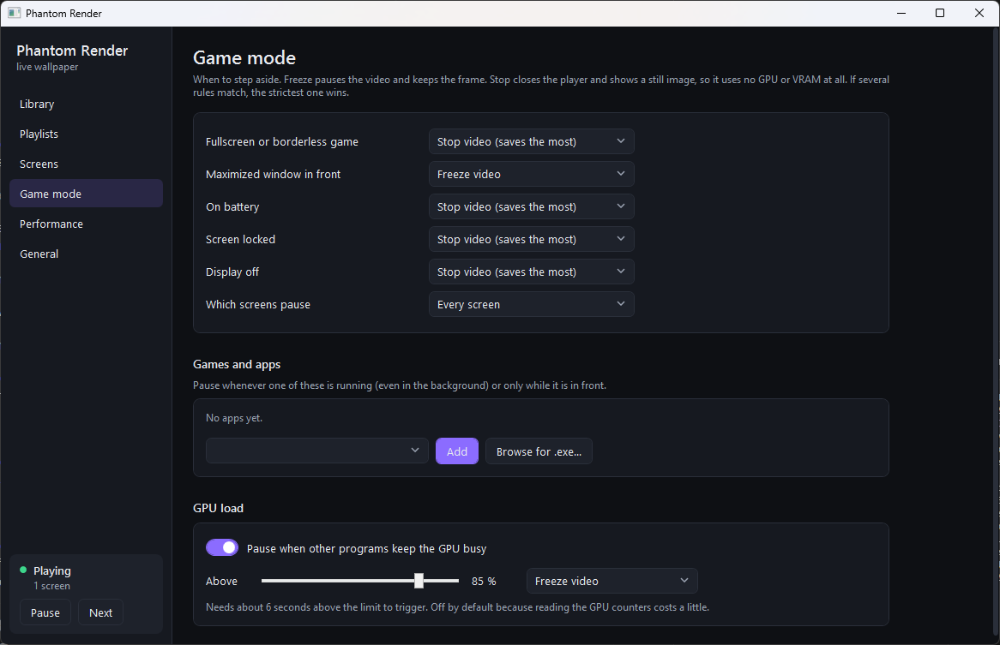
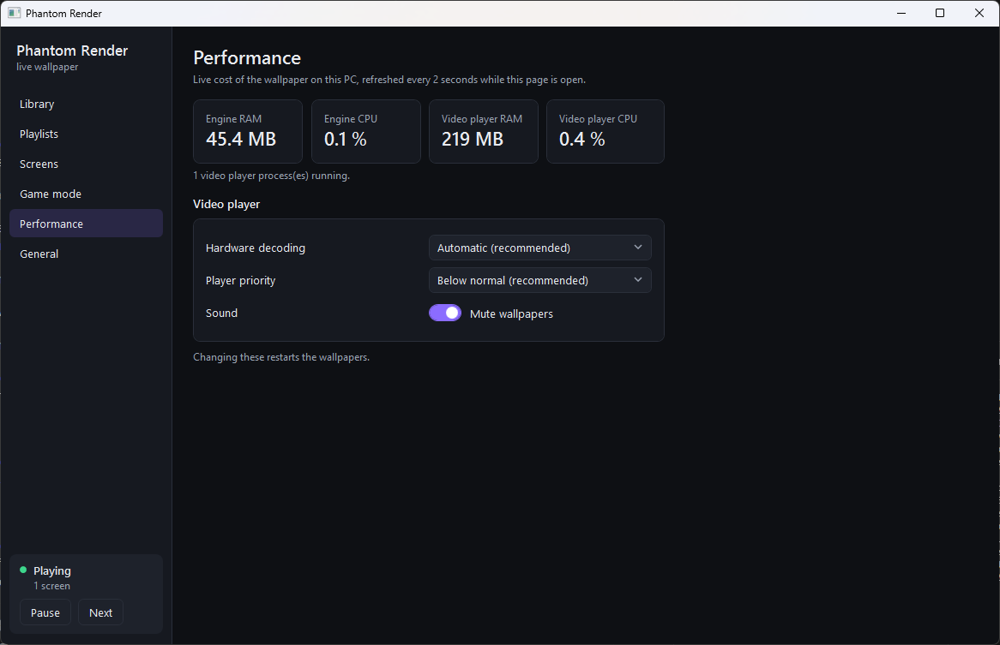

<p align="center"></p>

# Phantom Render – live wallpaper for gamers

Live video wallpapers for Windows, built for gamers. It's light while you play, and it gets out of the way when a game is fullscreen.

- Plays your videos behind the desktop icons with [mpv](https://mpv.io) and hardware decoding.
- Rotates through your folders on a timer, with a different wallpaper on each monitor or one spanning them all.
- When a fullscreen or borderless game is in front, it either **freezes** the video or **stops** the player and shows a still frame. In stop mode it uses no GPU or VRAM.
- It doesn't inject anything into games or hook them, so it doesn't interfere with anti-cheat.
- The engine is a small native (NativeAOT) exe, about 16 MB of RAM and ~0% CPU while idle.
- The control panel (`PhantomRender.exe`) is a separate program you open from the tray. When you close it, it's gone, so it costs nothing while you play.

## Install

1. Download `PhantomRender-win-Setup.exe` from the [latest release](../../releases/latest) and run it. You don't need admin rights; it installs only for your user account.
2. Windows may say *"Windows protected your PC"* because the installer isn't code-signed yet. Click **More info → Run anyway**.
3. A short setup asks three things:
   - your video folder
   - what happens while you play (stop or freeze)
   - whether to start with Windows

   It also downloads [mpv](https://mpv.io), the open-source video player Phantom Render uses (about 33 MB).

The installer adds the .NET 8 Desktop Runtime if it's missing. Updates install from the control panel (**General → Updates**), and only the changed files are downloaded.
To uninstall, use **Settings → Apps → Installed apps → Phantom Render**. Uninstalling stops the wallpaper, removes the startup entry and puts your previous Windows wallpaper back.

<p align="center">
  
  
</p>

## Control panel

- **Library:** your folders as a thumbnail grid. Double-click to show a video now. Right-click to pin it to a screen or add it to a playlist.
- **Playlists:** ordered or shuffled, each with its own interval.
- **Screens:** one wallpaper per screen or one across all of them, the playlist for each screen, and pinned wallpapers.
- **Game mode:** every pause rule, plus a game/app list you can fill from running programs or by browsing for an `.exe`.
- **Performance:** live RAM and CPU for the engine and the video player, hardware decoding and priority.
- **General:** start with Windows, the default interval, logs.

Thumbnails are made once with mpv at idle priority and cached. While a game rule is active, no thumbnails are made.
The control panel needs the [.NET 8 Desktop Runtime](https://dotnet.microsoft.com/download/dotnet/8.0). The engine doesn't.

## Build

Requires the .NET 8 SDK.

```powershell
scripts\get-mpv.ps1                    # downloads mpv.exe into tools\mpv (for running from publish\)
scripts\build.ps1 -Version 0.4.0       # publishes the engine + control panel into publish\
scripts\pack.ps1  -Version 0.4.0       # builds releases\PhantomRender-win-Setup.exe (needs: dotnet tool install -g vpk)
```

The engine is built with NativeAOT when the Visual Studio C++ tools are installed. Otherwise it falls back to a regular .NET build.
Pushing a tag like `v0.4.0` makes GitHub Actions build everything, including the native engine and the installer, and upload a **draft** release for you to review and publish.

## Settings

`%APPDATA%\WallpaperEngine\settings.json` (created on first run):

| key | default | meaning |
|---|---|---|
| `folders` | `[]` | folders scanned for videos (recursive) |
| `intervalMinutes` | `10` | time between automatic changes |
| `shuffle` | `true` | random order, otherwise alphabetical |
| `fullscreenMode` | `stop` | action while a fullscreen app or game is in front |
| `mute` | `true` | play without audio |
| `monitorMode` | `perMonitor` | `perMonitor` or `span` |
| `hwdec` | `auto-safe` | mpv hardware decoder |
| `mpvPriority` | `belowNormal` | process priority of mpv |
| `mpvPath` | – | explicit path to mpv.exe |

### Pause rules

Each action is `none`, `freeze` (pause the video, keep the frame) or `stop` (close mpv and show a still frame, so it uses no GPU or VRAM). When several rules match, the strictest one wins.

| key under `rules` | default | pauses when |
|---|---|---|
| (`fullscreenMode`, top level) | `stop` | a fullscreen or borderless app/game is focused |
| `maximized` | `freeze` | a maximized window is focused (it hides the wallpaper anyway) |
| `onBattery` | `stop` | the laptop is unplugged |
| `locked` | `stop` | the screen is locked |
| `displayOff` | `stop` | the display turns off |
| `apps` | `[]` | a listed app is running or focused, e.g. `{"exe": "VALORANT-Win64-Shipping.exe", "when": "running", "action": "stop"}`; `when` is `running` or `focused` |
| `gpu` | off | other programs use more than `threshold` % of the GPU's 3D engine for about 6 s: `{"enabled": true, "threshold": 85, "action": "freeze"}` |
| `scope` | `all` | `all` pauses every screen; `monitor` pauses only the screen the fullscreen or maximized window is on |

Lock and display changes arrive as Windows notifications, so they cost nothing while waiting. The process list for `running` rules is read every 5 s, and only when such a rule exists. The GPU counters are read every 2 s, only when the GPU rule is on.

The log is at `%LOCALAPPDATA%\WallpaperEngine\engine.log`. It records every pause along with its reason.

## Control pipe

The engine listens on `\\.\pipe\wpe_control` (current user only) for one JSON object per line:
`{"id":1,"cmd":"getState"}`, plus `next`, `setWallpaper` (`monitor`, `path`), `pause` (`paused`), `reloadSettings` and `stats`.
It answers with `{"id":1,"ok":true,...}` and pushes events such as `{"event":"wallpaperChanged",...}`.

## License

MIT, see [LICENSE](LICENSE). mpv isn't included in this repository; it's downloaded separately under its own license.
